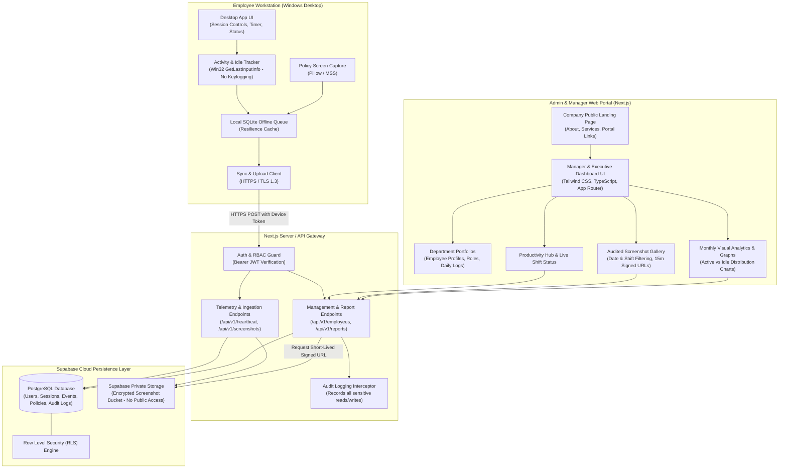
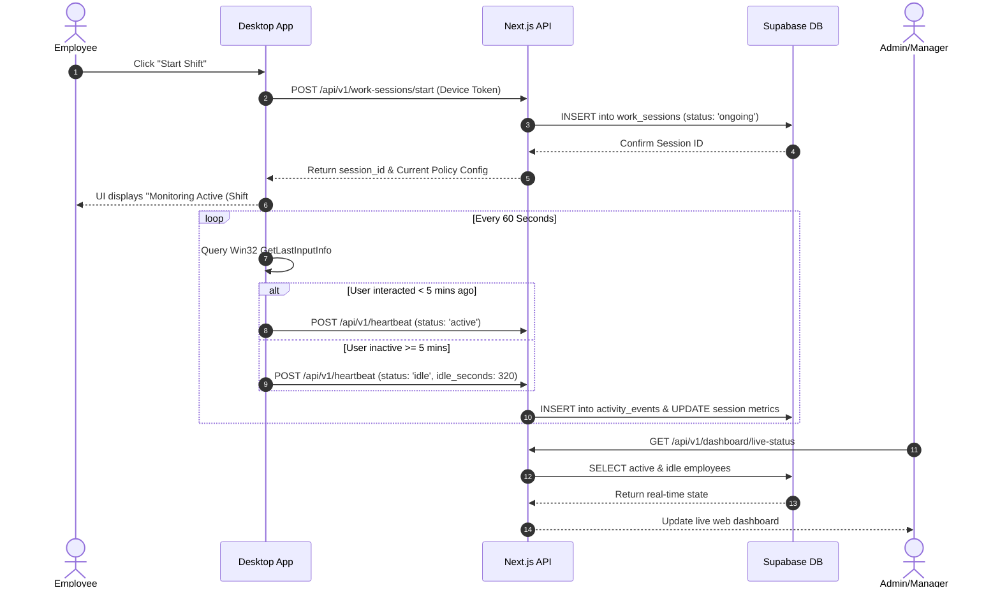
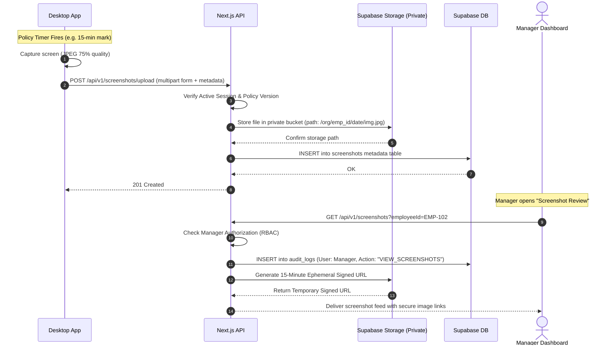

# System Architecture: Employee Productivity & Work Update Management System

> **Document Status:** Comprehensive System Architecture Design (Milestone 0)  
> **Author & Mentor:** Lubaba (লুবাবা)  
> **Audience:** HMk Borhan Uddin (Complete beginner guide with full professional architecture)

---

## 1. System Architecture Overview

The system is engineered across three foundational layers:
1. **Client Edge:** Employee Desktop Application (Windows 10/11 native).
2. **API & Business Logic Tier:** Next.js Serverless API endpoints with authentication & RBAC.
3. **Data & Storage Persistence:** Supabase PostgreSQL Database & Private Blob Storage.

---

## 2. Component Breakdown

### 2.1 Employee Desktop Application (Windows Prototype)
Built using Python to provide immediate native hardware interaction on Windows:
* **Session Controller:** Tracks shift state (`OFFLINE`, `ACTIVE`, `IDLE`, `BREAK`).
* **Hardware Activity Tracker:**
  * Uses the Windows native API `GetLastInputInfo` (via `ctypes`).
  * Measures idle duration (seconds elapsed since the last user keystroke or mouse movement).
  * **Strict Safety Guarantee:** Reads only the *time elapsed* since last event. It **never** intercepts key characters, text fields, or mouse coordinates.
* **Screen Capture Engine:**
  * Runs on a configurable timer (e.g., every 10 minutes) or trigger conditions dictated by organizational policy.
  * Encodes screenshots directly into optimized JPEG/WebP format with compression to minimize bandwidth.
* **Offline Resilience Queue (SQLite):**
  * If the office Wi-Fi or internet connection drops, events and screenshot files are stored in a local encrypted SQLite database (`local_cache.db`).
  * A background retry worker flushes the queue once internet connectivity is re-established.

---

### 2.2 Next.js API Layer (Backend)
Next.js serves as our unified API layer and backend service:
* **Ingestion Endpoints:**
  * `POST /api/v1/work-sessions/start` - Initiates a new work session.
  * `POST /api/v1/work-sessions/end` - Closes the active session with summary statistics.
  * `POST /api/v1/heartbeat` - Receives 60-second status pings (Active vs. Idle).
  * `POST /api/v1/work-updates` - Receives manual task updates submitted by employees.
  * `POST /api/v1/screenshots/upload` - Securely ingests screenshot binary data and registers metadata in PostgreSQL.
* **Management & Analytics Endpoints:**
  * `GET /api/v1/dashboard/live-status` - Supplies real-time team status for managers.
  * `GET /api/v1/screenshots?employee_id=...` - Returns audited, time-stamped screenshot records with 15-minute temporary signed URLs.
  * `GET /api/v1/reports/daily` - Aggregates shift hours, idle distribution, and task completions.
  * `POST /api/v1/audit-logs` - Automatically invoked whenever sensitive data is requested.

---

### 2.3 Data & Storage Tier (Supabase PostgreSQL + Private Storage)
* **PostgreSQL Relational Tables:**
  * Clean normalized schema with foreign keys and cascade rules.
  * Enforced Row-Level Security (RLS) ensuring that employees can only view their own records, managers can only view assigned teams, and admins manage systemic settings.
* **Private Storage Bucket (`employee-screenshots`):**
  * Bucket access is completely private (`public = false`).
  * Direct public HTTP access is disallowed. Images can only be viewed through ephemeral (temporary) cryptographic Signed URLs generated on-demand by authenticated managers.

---

## 3. Core Data Flow & Sequence Diagrams

### Sequence 1: Work Session Lifecycle (Start to Heartbeat to Idle)

---

### Sequence 2: Policy-Governed Screenshot Capture & Audited Review

---

## 4. Beginner Technical Glossary (সহজ বাংলা অভিধান)

| Technical Term | সহজ বাংলা ব্যাখ্যা (Metaphor & Definition) |
| :--- | :--- |
| **Frontend** | ওয়েবসাইটের যে রূপ বা ভিজ্যুয়াল ইন্টারফেস মানুষ ব্রাউজারে দেখে, বাটন ক্লিক করে এবং ব্যবহার করে। |
| **Backend** | ওয়েবসাইটের পেছনের অদৃশ্য মস্তিষ্ক বা ইঞ্জিন, যা সার্ভারে চলে এবং সমস্ত হিসাব-নিকাশ ও লজিক নিয়ন্ত্রণ করে। |
| **API (Application Programming Interface)** | দুটি সফটওয়্যারের একে অপরের সাথে নিরাপদ ভাষায় কথা বলার ডিজিটাল সেতু বা মাধ্যম। |
| **Endpoint** | API-এর সুনির্দিষ্ট ঠিকানা (URL), যেখানে কোনো রিকোয়েস্ট পাঠিয়ে কাজ করানো হয় (যেমন: `/api/v1/heartbeat`)। |
| **Database (PostgreSQL)** | তথ্যকে সুশৃঙ্খল ছক (Table), কলাম ও সারির মাধ্যমে চিরতরে জমা রাখার সুরক্ষিত ডিজিটাল আলমারি। |
| **Row-Level Security (RLS)** | ডাটাবেজের ভেতরেই পাহারাদার বসিয়ে দেওয়ার প্রযুক্তি—যাতে একজন কর্মচারী শুধুমাত্র তার নিজের ডেটা দেখতে পারে, অন্যের নয়। |
| **Signed URL** | কোনো সংরক্ষিত প্রাইভেট ফাইল দেখার জন্য তৈরি করা অস্থায়ী ডিজিটাল চাবি (Ticket), যা ১৫ বা ২০ মিনিট পর স্বয়ংক্রিয়ভাবে অচল হয়ে যায়। |
| **Heartbeat** | ডেক্সটপ অ্যাপ থেকে সার্ভারে নিয়মিত পাঠানো সংক্ষিপ্ত সংকেত ("আমি বেঁচে আছি এবং কাজ করছি"), যা দিয়ে লাইভ স্ট্যাটাস বোঝা যায়। |
| **Win32 GetLastInputInfo** | উইন্ডোজ অপারেটিং সিস্টেমের একটি নিরাপদ ফাংশন যা বলে দেয় ব্যবহারকারী শেষ কত সেকেন্ড আগে কীবোর্ড বা মাউস ছুঁয়েছিলেন (কিন্তু কোনো পাসওয়ার্ড বা লেখা রেকর্ড করে না)। |
